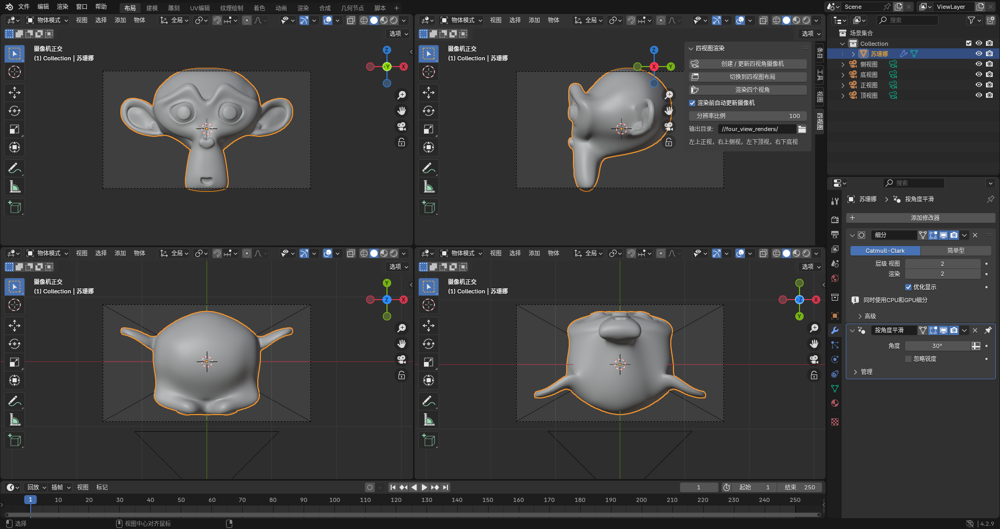

# Four View Render

给 Blender 加一个"四视图"工作流：一键生成正 / 侧 / 顶 / 底四个正交视角，把当前工作区切成十字四格并分别绑定摄像机，然后批量渲染出四张图。做三视图展示、转面参考图、模型验证图很省事。



> 上图为 Blender 4.2.3 中的实际效果：侧栏「四视图」面板 + 十字四格视图，每格已绑定各自的正交摄像机。

- 作者：Aero
- 插件版本：1.4.0
- 适配 Blender：**3.1.0 起**（`bl_info` 中声明的 `blender` 下限），向上适配 3.2 / 4.x / 5.x
- 截图环境：Blender 4.2.3

> 版本支持分成两层：安装能不能装上（见下面的安装章节），以及运行时接口有没有适配（见兼容性章节）。

## 功能

### 1. 创建 / 更新四视角摄像机

自动统计场景中所有参与渲染的物体，算出包围盒的中心和最大边长（×1.2 留边），在四个方向上各摆一台正交摄像机，全部对准中心。生成的四台摄像机名字固定：

| 摄像机 | 朝向 | 画面上方向 |
|---|---|---|
| `正视图` | 从 -Y 看向 +Y | +Z |
| `侧视图` | 从 +X 看向 -X | +Z |
| `顶视图` | 从 +Z 向下 | +Y |
| `底视图` | 从 -Z 向上 | -Y |

重复执行是"更新"而不是"新建"，位置、正交缩放、朝向都会重算一遍。摄像机按 `+Z` 朝向和 `+Y` 上方向直接构造正交基，而不是用 `to_track_quat('-Z','Y')`，所以顶/底视图不会因为共线退化出现朝向错乱。

### 2. 切换到四视图布局

把当前工作区的 3D 视口整理成均分的十字四格，并给每格设置"本地摄像机"，绑上对应机位。排布固定为：

| 位置 | 绑定机位 |
|---|---|
| 左上 / 右上 | 正视图 / 侧视图 |
| 左下 / 右下 | 顶视图 / 底视图 |

如果当前工作区里 3D 视口不止一个，会先合并到只剩一个、再重新分割，所以结果是"重置成标准四格"而不是叠加。只处理 3D 视口，时间轴、大纲、属性这些面板不动。

整个分割/合并是放在 `bpy.app.timers` 里分帧推进的，等 Blender 把新分出来的区域几何算完再继续，避免一次性操作拿到尺寸为 0 的视口。

### 3. 渲染四个视角

依次切换四台摄像机各渲一张，文件名就是摄像机名，存到输出目录。渲染时：

- 分辨率百分比临时替换为面板设置的值，渲完还原；
- 临时关闭时间轴标记上绑定的摄像机，以及所有 3D 视口的"本地摄像机"覆盖，防止侧栏那个视口把整批渲染全顶成同一个视角；
- 结束后原样恢复以上所有状态，并重新给四格绑定摄像机。

渲染格式、分辨率、采样、色彩管理这些全部跟随场景自身的渲染设置，插件只改分辨率百分比。

## 安装

### 方式一：安装单文件（推荐）

本仓库提供的是**传统 `bl_info` 单文件插件**，不是扩展格式。Blender 4.2 起偏好设置把两种安装方式拆成了两个入口，选错会提示文件无效：

| Blender 版本 | 用哪个按钮 | 说明 |
|---|---|---|
| 3.1 ~ 4.1 | `从磁盘安装`（Install from Disk） | 插件页右上角，直接选 `.py` |
| 4.2 ~ 5.x | `安装旧式插件`（Install Legacy Add-on） | 插件页右上角的下拉菜单里，**不要**用 "Install from Disk"，那个只认带 `blender_manifest.toml` 的扩展包 |

步骤：

1. 下载本仓库的 [`four_view_render.py`](four_view_render.py)；
2. 打开 Blender → `编辑` → `偏好设置` → `插件`（Add-ons）；
3. 按上表找到对应按钮，选中 `four_view_render.py`；
4. 在插件列表里搜索 `Four View`，勾选启用。

装好后 3D 视图按 `N`，侧栏会出现「四视图」标签页。

> Blender 5.x 仍然加载旧式插件，但官方已把它定位成过渡方案：新代码建议改写成扩展格式（方式三）。

### 方式二：手动放进插件目录

把 `four_view_render.py` 复制到下面任一路径（`<版本>` 换成你的 Blender 版本号，如 `4.2`）：

| 系统 | 路径 |
|---|---|
| Windows | `%APPDATA%\Blender Foundation\Blender\<版本>\scripts\addons\` |
| macOS | `~/Library/Application Support/Blender/<版本>/scripts/addons/` |
| Linux | `~/.config/blender/<版本>/scripts/addons/` |

也可以用"便携模式"：放进 Blender 安装目录下的 `<版本>/scripts/addons/`，重开 Blender 后在偏好设置里启用。

这条路 4.2 ~ 5.x 同样有效，不依赖 `blender_manifest.toml`，属于旧式插件的加载路径。

### 方式三：做成扩展（Blender 4.2+ 扩展平台）

新建文件夹 `four_view_render/`，把 `__init__.py`（内容就是本仓库的 `four_view_render.py`）和下面这个 `blender_manifest.toml` 放进去，打包成 zip 后 `从磁盘安装`：

```toml
schema_version = "1.0.0"

id = "four_view_render"
version = "1.4.0"
name = "Four View Render"
tagline = "One-click orthographic front / side / top / bottom views"
maintainer = "Aero"
type = "add-on"

blender_version_min = "4.2.0"

license = ["SPDX:MIT"]

[permissions]
files = "Render output is written to the folder set in the panel"
```

注意扩展格式要求英文元信息，仓库里的单文件版保留了中文 `bl_info`，用方式一 / 二安装即可。想把插件上架到 extensions.blender.org，必须走这条扩展路线。

## 使用

1. 摆好模型，3D 视图按 `N` 打开侧栏，找到「四视图」标签页；
2. 点 **创建 / 更新四视角摄像机** —— 生成（或更新）四台正交机位；
3. 点 **切换到四视图布局** —— 当前工作区变十字四格，每格显示一个方向；
4. 调好渲染设置，点 **渲染四个视角** —— 四张图落到输出目录。

物体之后改大了、挪位置了，勾着「渲染前自动更新摄像机」就不用再手动点第 2 步。

## 参数

| 参数 | 默认 | 说明 |
|---|---|---|
| 渲染前自动更新摄像机 | 开启 | 每次渲染前重算包围盒、重摆四台机位 |
| 分辨率比例 | 100 | 渲染时临时生效的 `resolution_percentage`，渲完还原 |
| 输出目录 | `//four_view_renders/` | 相对 `.blend` 文件的路径。文件未保存过时自动落到系统临时目录 |

## 输出

```
<输出目录>/
├── 正视图.png（或场景设定的图片格式）
├── 侧视图.*
├── 顶视图.*
└── 底视图.*
```

扩展名由场景的 `渲染 → 输出 → 文件格式` 决定。

## 兼容性

### 版本支持一览

| Blender | 安装方式 | 运行时走的接口 |
|---|---|---|
| 3.1 | `从磁盘安装` | 旧式 override 字典（作为算子第一个位置参数传入） |
| 3.2 ~ 4.1 | `从磁盘安装` | `context.temp_override()` |
| 4.2 ~ 4.5 | `安装旧式插件` | `temp_override()` + 4.3 起改用 `area_join(source_xy, target_xy)` |
| 5.x | `安装旧式插件`（官方定位为过渡方案） | 同 4.3+ 路径，已按 5.x 的签名差异适配到 5.2.3 |

`bl_info` 里声明的是 `"blender": (3, 1, 0)`，即最低 3.1.0，未设最高限制。

> 截图与当前验证环境是 4.2.3。其它版本上如果碰到算子报错，欢迎提 issue，附上版本号和报错文本。

### 内部适配细节

插件对 Blender 的接口差异做了分层适配，一套代码跨版本跑：

| 环节 | 3.1 | 3.2 ~ 4.x | 4.3+ |
|---|---|---|---|
| 上下文覆盖 | 旧式 override 字典（作为第一个位置参数传入） | `context.temp_override()` | `context.temp_override()` |
| 区域合并 | `area_join(cursor=...)` | `area_join(cursor=...)` | `area_join(source_xy=..., target_xy=...)` |
| 兜底 | `screen.area_close()` 关闭多余视口 | 同左 | 同左 |

调用 `bpy.ops` 前还会检查算子实际接受的属性名，不存在的参数不传，避免版本间报 "unexpected keyword argument"。

## 注意事项

- **摄像机名被占用会直接报错**。场景里已有叫"正视图"的网格 / 空物体时，会提示"对象名已被非摄像机占用"，改名或删掉再执行。
- **包围盒只排除关闭了"渲染可见"的物体**。在视口里隐藏、但仍参与渲染的物体会被算进去，想让它不参与构图就关掉渲染可见性。
- **四视图布局改的是当前工作区**，不是新建窗口。想保留原布局，先存文件或切到别的 workspace 再点。
- **四个视角共用一个正交缩放**，取包围盒三轴最大边长。扁长物体在某些视角会留大片空白，需要时手动调 `ortho_scale` 或单独挪机位。
- 输出目录设成 `//` 相对路径时，`.blend` 没存过盘会写进系统临时目录（面板提示里的路径不是最终位置）。

## 仓库结构

```
.
├── four_view_render.py    # 插件本体（单文件 add-on）
├── images/
│   └── panel.png          # README 截图
├── LICENSE
└── README.md
```

## License

MIT，见 [LICENSE](LICENSE)。
